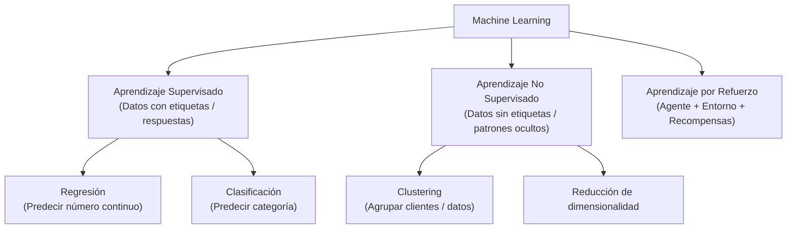
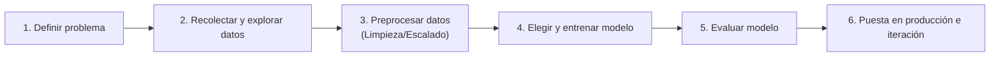

# Sesión 1: Introducción a Machine Learning y Estadística Básica

---

## 1. ¿Qué es Machine Learning?

> **Definición:** El Machine Learning (Aprendizaje Automático) es una rama de la Inteligencia Artificial centrada en algoritmos que aprenden patrones a partir de datos de entrenamiento para realizar inferencias o predicciones precisas sobre datos nuevos nunca vistos.

### Programación Tradicional vs. Machine Learning

| Enfoque | Entrada | Proceso | Salida |
| :--- | :--- | :--- | :--- |
| **Programación Tradicional** | Datos + **Reglas escritas a mano** | La computadora ejecuta las reglas paso a paso | **Resultados** |
| **Machine Learning** | Datos + **Resultados esperados** | El algoritmo descubre las relaciones y patrones | **Reglas (el Modelo)** |

*En vez de programar un millón de reglas `if / else` para reconocer un gato o detectar spam, le mostramos miles de ejemplos y dejamos que el modelo aprenda la lógica subyacente.*

### Casos de uso reales
- **Sistemas de recomendación:** Netflix, Spotify, YouTube.
- **Filtros de spam:** Detección automática en Gmail/Outlook.
- **Visión por computadora:** Reconocimiento facial, autos autónomos (Tesla, Waymo).
- **Medicina asistida:** Detección de tumores en tomografías.
- **Procesamiento de Lenguaje Natural:** Traductores (Google Translate), modelos de lenguaje (LLMs).

---

## 2. Tipos de Aprendizaje

1. **Aprendizaje Supervisado:** Se entrena con pares $(X, y)$, donde $X$ son las características y $y$ es la etiqueta correcta.
   - **Clasificación:** La salida es una etiqueta discreta o categoría (ej. ¿Es spam o no? ¿Es perro, gato o pájaro?).
   - **Regresión:** La salida es un valor numérico continuo (ej. Predecir el precio de una casa, la temperatura de mañana).
2. **Aprendizaje No Supervisado:** Solo tenemos $X$, sin etiquetas $y$. El algoritmo busca patrones, agrupamientos o estructura oculta.
   - *Ejemplo típico:* Segmentación o clustering de clientes de un supermercado por hábitos de compra.
3. **Aprendizaje por Refuerzo:** Un agente interactúa con un entorno mediante ensayo y error, recibiendo recompensas o penalizaciones.
   - *Ejemplo:* Modelos para jugar ajedrez, Go (AlphaGo) o videojuegos.

---

## 3. Flujo de Trabajo en un Proyecto de ML

> [!IMPORTANT]
> Más del **70% u 80% del tiempo** en un proyecto real se dedica a la recolección, exploración y limpieza de datos, no a programar el algoritmo de ML.

### Vocabulario Fundamental
- **Dataset:** Colección de datos tabulares organizada en filas y columnas.
- **Feature (Variable de entrada / característica):** Cada columna predictora ($X$). Ej: metros cuadrados, cantidad de ambientes.
- **Target (Etiqueta / variable objetivo):** La variable que queremos predecir ($y$). Ej: precio de venta.
- **Modelo:** Función matemática o algoritmo entrenado que mapea entradas $X$ a predicciones $\hat{y}$.
- **Entrenamiento (Training / Fit):** El proceso matemático de ajustar los parámetros internos del modelo para minimizar el error.
- **Overfitting (Sobreajuste):** Ocurre cuando el modelo memoriza el conjunto de entrenamiento (incluido el ruido) en lugar de aprender patrones generales; falla al ver datos nuevos.

---

## 4. Probabilidad y Estadística para ML

El Machine Learning es matemática y estadística computacional aplicada. Cada dataset es una **muestra** de una población general.

### Medidas de Tendencia Central
- **Media ($\bar{x}$):** Promedio de los valores:
  $$\bar{x} = \frac{1}{n} \sum_{i=1}^n x_i$$
- **Mediana:** El valor central cuando los datos están ordenados de menor a mayor.
- **Moda:** El valor más frecuente.

> [!NOTE]
> **Sensibilidad a Outliers (valores atípicos):**  
> Si 5 personas ganan \$1,000 y una gana \$100,000:
> - Mediana = \$1,000 (representativa de la mayoría).
> - Media $\approx$ \$17,500 (distorsionada por el valor extremo).

### Medidas de Dispersión
- **Varianza ($\sigma^2$):** Promedio de las distancias al cuadrado respecto a la media:
  $$\sigma^2 = \frac{1}{n}\sum_{i=1}^n (x_i - \bar{x})^2$$
- **Desvío Estándar ($\sigma$):** Raíz cuadrada de la varianza ($\sigma = \sqrt{\sigma^2}$). Indica cuánto se alejan los datos respecto a la media en sus unidades originales.

### Distribución Normal (Campana de Gauss)
- Es simétrica alrededor de su media.
- Gran cantidad de fenómenos naturales y mediciones se distribuyen de esta forma.
- Muchos algoritmos asumen que las variables tienen una distribución normal o cercana a ella.

### Probabilidad Condicional
- $P(A)$: Probabilidad de que ocurra $A$ ($0 \le P(A) \le 1$).
- $P(A \mid B)$: Probabilidad de que ocurra $A$ **sabiendo de antemano que $B$ ya ocurrió**.
  - *Ejemplo:* $P(\text{Spam} \mid \text{contiene la palabra 'gratis'})$ es mucho mayor que $P(\text{Spam})$ en general.

### Correlación Lineal
Mide el grado de asociación lineal entre dos variables numéricas, en el rango $[-1, 1]$:
- $+1$: Relación positiva perfecta (al subir una variable, sube la otra).
- $-1$: Relación negativa perfecta (al subir una variable, baja la otra).
- $0$: No hay relación lineal.

> [!WARNING]
> **Correlación no implica causalidad:** Que dos variables suban al mismo tiempo no significa que una cause a la otra (pueden depender de una tercera variable oculta o ser mera coincidencia).
