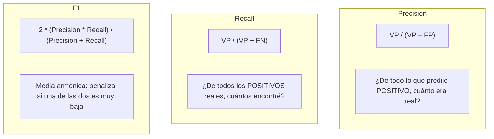
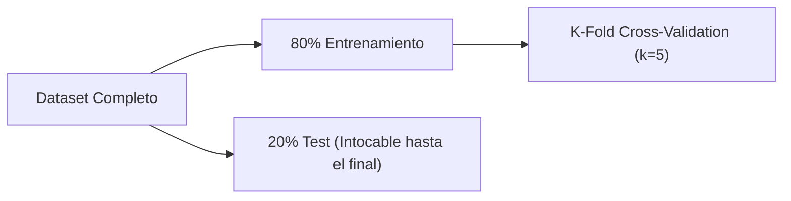

# Sesión 5: Evaluación de Modelos y Validación

---

## 1. La Paradoja del Accuracy en Clases Desbalanceadas

> [!WARNING]
> Un valor de **Accuracy alto NO garantiza que el modelo sea útil**.

**Ejemplo del detector de fraudes:**
- Un banco tiene 10.000 transacciones bancarias, de las cuales solo 200 son fraudes (2%).
- Si creamos una función "tonta" (dummy) que siempre diga: `return "No es fraude"`:
  $$\text{Accuracy} = \frac{9800}{10000} = 98\%$$
- ¡El modelo tiene 98% de exactitud pero **dejó pasar el 100% de los fraudes**!

Siempre que una clase sea mucho más frecuente que otra (fraudes, diagnósticos médicos de enfermedades raras, fallas industriales), el **Accuracy es una métrica engañosa**.

---

## 2. La Matriz de Confusión

La matriz de confusión compara lo que predijo el modelo frente a la realidad:

```
                      PREDICCIÓN DEL MODELO
                 Predijo 0 (Negativo)  |  Predijo 1 (Positivo)
               +-----------------------+-----------------------+
  Real 0       |   Verdadero Negativo  |    Falso Positivo     |
  (Negativo)   |         (VN)          |         (FP)          |
REALIDAD       +-----------------------+-----------------------+
  Real 1       |    Falso Negativo     |  Verdadero Positivo   |
  (Positivo)   |         (FN)          |         (VP)          |
               +-----------------------+-----------------------+
```

- **VN:** Dijo negativo y era negativo (ej: compra legítima permitida).
- **VP:** Dijo positivo y era positivo (ej: fraude detectado exitosamente).
- **FP (Falsa alarma / Error Tipo I):** Dijo positivo pero era negativo (ej: bloquear la tarjeta de un cliente inocente).
- **FN (Omisión / Error Tipo II):** Dijo negativo pero era positivo (ej: dejar pasar una compra con tarjeta robada o no detectar un tumor).

---

## 3. Métricas Específicas de Clasificación



### 3.1. Precision (Precisión / Valor Predictivo Positivo)
$$\text{Precision} = \frac{\text{VP}}{\text{VP} + \text{FP}}$$
- **Foco:** Evitar falsas alarmas (FP).
- **Cuándo priorizar Precision:** Filtros de spam (no queremos mandar correos laborales importantes a spam) o recomendaciones de contenido.

### 3.2. Recall (Sensibilidad / Exhaustividad / True Positive Rate)
$$\text{Recall} = \frac{\text{VP}}{\text{VP} + \text{FN}}$$
- **Foco:** No dejar escapar ningún caso positivo real (minimizar FN).
- **Cuándo priorizar Recall:** Diagnóstico médico de enfermedades graves o detección de fraudes bancarios.

### 3.3. F1-Score (Equilibrio)
$$\text{F1} = 2 \cdot \frac{\text{Precision} \cdot \text{Recall}}{\text{Precision} + \text{Recall}}$$
- Es la **media armónica** entre Precision y Recall.
- Un modelo que prediga positivo siempre tendrá Recall = 1.0 pero Precision casi cero; su F1 será pésimo. El F1 solo es alto si **ambas** métricas son altas.

### 3.4. El Umbral de Decisión y el Dilema Precision vs. Recall
- **Bajar el umbral (ej: de 0.5 a 0.25):** El modelo predice positivo con mayor facilidad $\implies$ **Sube el Recall, baja la Precision**.
- **Subir el umbral (ej: de 0.5 a 0.80):** El modelo solo se arriesga si está segurísimo $\implies$ **Sube la Precision, baja el Recall**.

### 3.5. Métricas para Regresión
- **MAE (Mean Absolute Error):** $\frac{1}{n}\sum |y_i - \hat{y}_i|$. Error promedio directo en las mismas unidades del target.
- **RMSE (Root Mean Squared Error):** $\sqrt{\frac{1}{n}\sum (y_i - \hat{y}_i)^2}$. Penaliza más las desviaciones severas.
- **$R^2$:** Varianza explicada ($0$ a $1$).

---

## 4. Overfitting, Validación y el Conjunto de Test



### 4.1. "La Trampa" de optimizar sobre el Test Set
Si probamos 20 combinaciones de hiperparámetros y miramos cuál da mejor resultado en `X_test`, hemos utilizado el conjunto de prueba para tomar decisiones de diseño. El resultado ya no será representativo porque el modelo se ajustó indirectamente al test.

### 4.2. Validación Cruzada (k-Fold Cross-Validation)

Un solo split train/test depende del azar (lotería estadística según qué datos cayeron en cada parte).

**Mecanismo de k-Fold:**
1. Se divide el conjunto de entrenamiento en $k$ partes iguales (típicamente $k=5$ o $k=10$).
2. Se entrena $k$ veces: en cada iteración, una parte diferente actúa como conjunto de validación y las restantes $k-1$ para entrenar.
3. Se promedian los puntajes y se calcula el desvío estándar ($\mu \pm \sigma$).

### 4.3. Búsqueda de Hiperparámetros con `GridSearchCV`
Prueba automáticamente todas las combinaciones posibles de una grilla de hiperparámetros evaluadas mediante validación cruzada interna.

### 4.4. Fuga de Datos (Data Leakage)
Ocurre cuando información del conjunto de test o validación se filtra en la fase de entrenamiento:
- *Error clásico:* Aplicar `scaler.fit_transform(X)` sobre **todo** el dataset antes de hacer `train_test_split`. La media y varianza del test se filtran en el entrenamiento.
- *Solución:* Usar **Pipelines** de scikit-learn, que encapsulan el escalador y el modelo de manera que el escalador solo aprenda de los folds de train en cada iteración.

---

## 5. Código Resumen de la Clase

```python
from sklearn.metrics import confusion_matrix, classification_report, ConfusionMatrixDisplay
from sklearn.model_selection import cross_val_score, GridSearchCV
from sklearn.pipeline import make_pipeline
from sklearn.preprocessing import StandardScaler
from sklearn.tree import DecisionTreeClassifier

# 1. Reporte completo de clasificación
y_pred = modelo.predict(X_test)
print(classification_report(y_test, y_pred))

# 2. Pipeline seguro con Validación Cruzada
pipeline = make_pipeline(StandardScaler(), DecisionTreeClassifier())
scores = cross_val_score(pipeline, X_train, y_train, cv=5, scoring="f1")
print(f"F1 promedio CV: {scores.mean():.3f} +/- {scores.std():.3f}")

# 3. Optimización con GridSearchCV
grilla = {
    "decisiontreeclassifier__max_depth": [2, 3, 5, 8],
    "decisiontreeclassifier__min_samples_leaf": [1, 5, 10]
}
busqueda = GridSearchCV(pipeline, grilla, cv=5, scoring="f1")
busqueda.fit(X_train, y_train)

print("Mejores parámetros:", busqueda.best_params_)
print("Resultado final en TEST (visto una sola vez):", busqueda.score(X_test, y_test))
```
